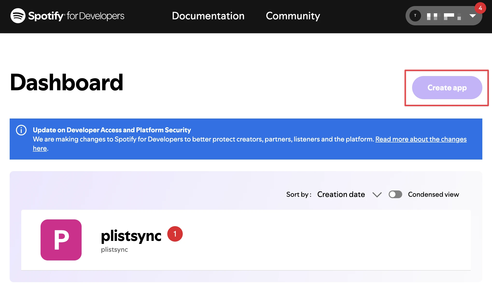

# Getting Started

This guide sets up the Spotify integration with `plistsync` from start to finish. Once
connected, you can browse, search, create, and edit your Spotify playlists from the CLI
or the library, and sync them with other services.

## Prerequisites

### Spotify account

You need an active and paid [Spotify account](https://accounts.spotify.com/).

```{note}
Since February 2026, Spotify
- no longer allows access to its API for free accounts
- and limits us to 5 users per App, even for paid accounts.

This means we can no longer provide working API credentials for plistsync users. You have to create your own credentials.
```

### API credentials

To authenticate with Spotify's API, you need to obtain API credentials:

1. Visit the [Spotify Developer Portal](https://developer.spotify.com/)
2. Log in with your paid Spotify account
3. Create a new application
4. Generate your `client_id` (the `client_secret` is not needed, `plistsync` uses PKCE)




## Installation

Install the Spotify optional dependencies:

```{plistsync-install} spotify
```

## Configuration

::::{tab-set}
:sync-group: config-method

:::{tab-item} CLI
:sync: cli

By default the `spotify` service has a configuration section in your `plistsync` configuration file. If not, add the following snippet to your `config.yaml`:

```{plistsync-config} plistsync.services.spotify.config.SpotifyConfig
:service: spotify
```

:::

:::{tab-item} Library (inline)
:sync: library

Construct a spotify configuration in code from custom values you provide
directly:

```{plistsync-config} plistsync.services.spotify.config.SpotifyConfig
:type: library
```

:::

:::{tab-item} Library (from file)
:sync: file

Load the configuration from your user config directory, where the CLI stores the
values you configured:

```{plistsync-config} plistsync.services.spotify.config.SpotifyConfig
:type: file
```

:::

::::

## Authentication

Spotify uses OAuth: you log in once, after setting your `client_id` above. Start the
browser flow with the CLI:

```bash
plistsync spotify auth
```

On a machine without a browser, pass `--mode manual` and paste the redirected URL
instead:

```bash
plistsync spotify auth --mode manual
```

The token is stored in your Spotify config and reused by all later commands. Check it
at any time; `--check` prints `authenticated` and exits `0` when the token is valid, or
`not authenticated` and exits non-zero otherwise:

```bash
plistsync spotify auth --check
```

To authenticate from Python instead of the CLI, see the
[authentication guide](../../library/guides/authentication.md).

```{typer} plistsync.cli.app:app::spotify:auth
---
prog: plistsync spotify auth
width: 80
---
```

## Verify

List the playlists `plistsync` can see for your account:

```bash
plistsync spotify playlist list
```

If your playlists are printed, the service is installed, configured, and authenticated
correctly.

## Next steps

- [CLI quickstart](../../cli/getting-started.md): create, edit, and search playlists from the terminal.
- [CLI commands](../../cli/commands.md): the shared commands and conventions.
- [Sync playlists](../sync/index.md): keep this service in step with the others.
- [Core concepts](../../core-concepts.md): services, capabilities, playlists, and tracks.
